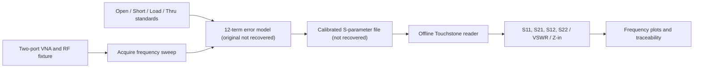

# Reconstructed RF analysis methodology

**Basis:** The published portfolio states a 2025 MATLAB workflow for two-port S-parameter testing, 12-term SOLT calibration, and a nominal 100 MHz to 6 GHz measurement range. No original source/measurement records were found in this recovery pass. The calculations here are standard RF theory, newly implemented for offline data.

## Conceptual signal chain



The reconstruction **only implements F through H**. The diagram describes the reported end-to-end methodology, not a claim that a complete calibrated VNA has been built or retested.

## S-parameters

For a linear two-port, incident waves `a1,a2` and reflected waves `b1,b2` are related by:

```text
[b1]   [S11 S12] [a1]
[b2] = [S21 S22] [a2]
```

- `S11`: input reflection with port 2 matched
- `S21`: forward transmission, port 1 to port 2
- `S12`: reverse transmission, port 2 to port 1
- `S22`: output reflection with port 1 matched

The standard **Touchstone 1.0 two-port data ordering** is `frequency S11 S21 S12 S22`, with each S-parameter occupying two numeric values. The supported option line is `# GHz S DB R 50` or another supported frequency unit and `RI/MA/DB` representation. Touchstone 2.0 matrices, mixed-mode data, noise sections and arbitrary reference impedance lists are **not supported**.

## Reconstructed calculations

For complex reflection coefficient `Gamma = S11` and real positive reference impedance `Z0`:

```text
S11_dB = 20 log10(|S11|)
S21_dB = 20 log10(|S21|)
ReturnLoss_dB = -20 log10(|S11|)
VSWR = (1 + |S11|) / (1 - |S11|)     when |S11| < 1
Zin = Z0 * (1 + S11) / (1 - S11)
```

At `|S11| >= 1`, the offline JSON sets VSWR to `null` rather than reporting a misleading finite VSWR. At `S11 = 1`, impedance is singular. For zero coefficient, `log10(0)` is undefined in finite JSON; the JSON analyzer reports a `null` dB field. Neither result indicates bad data by itself.

For Touchstone DB form, `S = 10^(magnitude_dB/20) * exp(j*phase_deg*pi/180)`. MA uses linear magnitude; RI uses real and imaginary components.

## Additional offline two-port consistency diagnostics

The **newly reconstructed Python checker**, not the original Honors measurement code, also derives two diagnostics from a full complex 2×2 S-matrix at each synthetic frequency point:

- **Reciprocity difference:** `|S21 - S12|`. A zero difference is algebraically consistent with a reciprocal two-port at that point; a nonzero value may be expected for active or nonreciprocal devices and is not automatically a measurement error.
- **Maximum power-wave gain:** the largest eigenvalue of `SᴴS`, equal to the square of the greatest singular value of S. For a linear passive two-port with the same real positive reference impedance at both ports, this value must not exceed 1. This is stronger than checking the two input columns separately because coherent superpositions can have greater gain.

For `S = [[S11,S12],[S21,S22]]`, let `a = |S11|² + |S21|²`, `d = |S12|² + |S22|²`, and `b = conj(S11)×S12 + conj(S21)×S22`. Then:

```text
max_power_gain = [a + d + sqrt((a - d)² + 4|b|²)] / 2
passivity_compatible = max_power_gain <= 1 + 1e-9
reciprocity_difference_abs = |S21 - S12|
```

The `1e-9` numerical tolerance avoids treating minor rounding above unity as a definite inconsistency. It is **not** an instrument-uncertainty model.

### Independent synthetic examples

| S matrix | Maximum power-wave gain | Reciprocity difference | Algebraic reading |
| --- | ---: | ---: | --- |
| Matched attenuator, S21=S12=0.5 | 0.25 | 0 | Compatible with passive and reciprocal behavior |
| Ideal through, S21=S12=1 | 1.00 | 0 | Passive boundary |
| One-way attenuator, S21=0.5, S12=0 | 0.25 | 0.5 | Passive-compatible, not reciprocal |
| Gain example, S21=2, S12=0 | 4.00 | 2 | Not passive-compatible |
| Coupled S11=S22=0.8, S21=S12=0.6 | 1.96 | 0 | Not passive-compatible despite each input column norm being 1 |

All unspecified entries in the first four matrices are zero. All entries are artificial, dimensionless, frequency-specific teaching values, not original measured RF sweeps.

The JSON includes these diagnostics under `measurements[].diagnostics`. They are **necessary algebraic consistency indicators only**. Without known reference impedances, trustworthy calibration, uncertainties, a properly identified device and traceable captures, the checker cannot verify actual passivity, actual reciprocity or any equipment performance. A real active or nonreciprocal DUT can legitimately fail these passive/reciprocal assumptions.

## Practical interpretation

- A `-20 dB` S11 corresponds to `|Gamma|=0.1` and VSWR approximately `1.222`.
- A `-3 dB` S21 corresponds to linear wave-magnitude approximately `0.708`.
- Small `S11` is generally favorable for a matched passive port, but actual DUT requirements determine acceptance.
- Passive, reciprocal assumptions are *not made* by the parser. An active device can have power gain.
- For best traceability, preserve calibration date, standard kit definitions, port mapping, frequency grid, reference impedance, DUT identification and untouched `.s2p` exports.

## Software limitations

The reconstructed MATLAB routine draws a *reflection-coefficient plane with a unit circle*, not a calibrated Smith chart. These utilities do not guarantee numerical uncertainty or correctness of source calibration; they process whatever S2P input is provided. Additional VNA vendor-specific or Touchstone 2.0 support requires a separate implementation.
